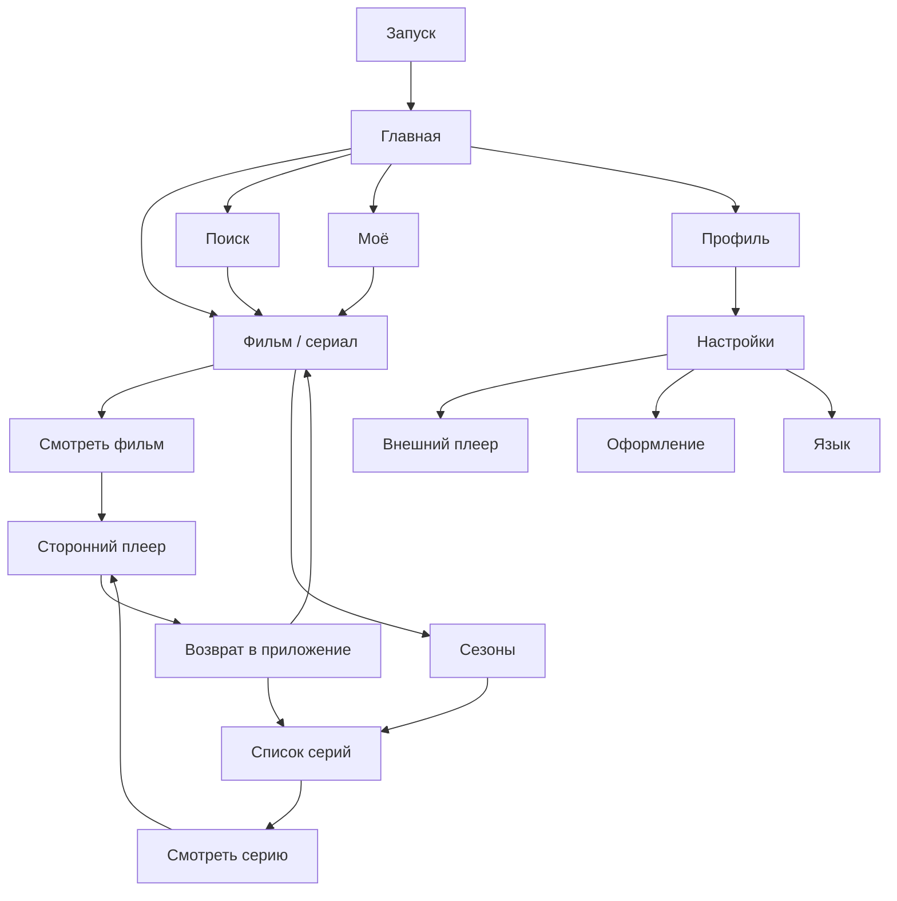
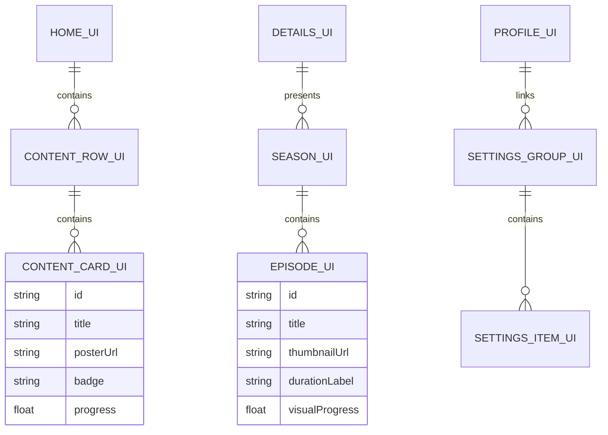
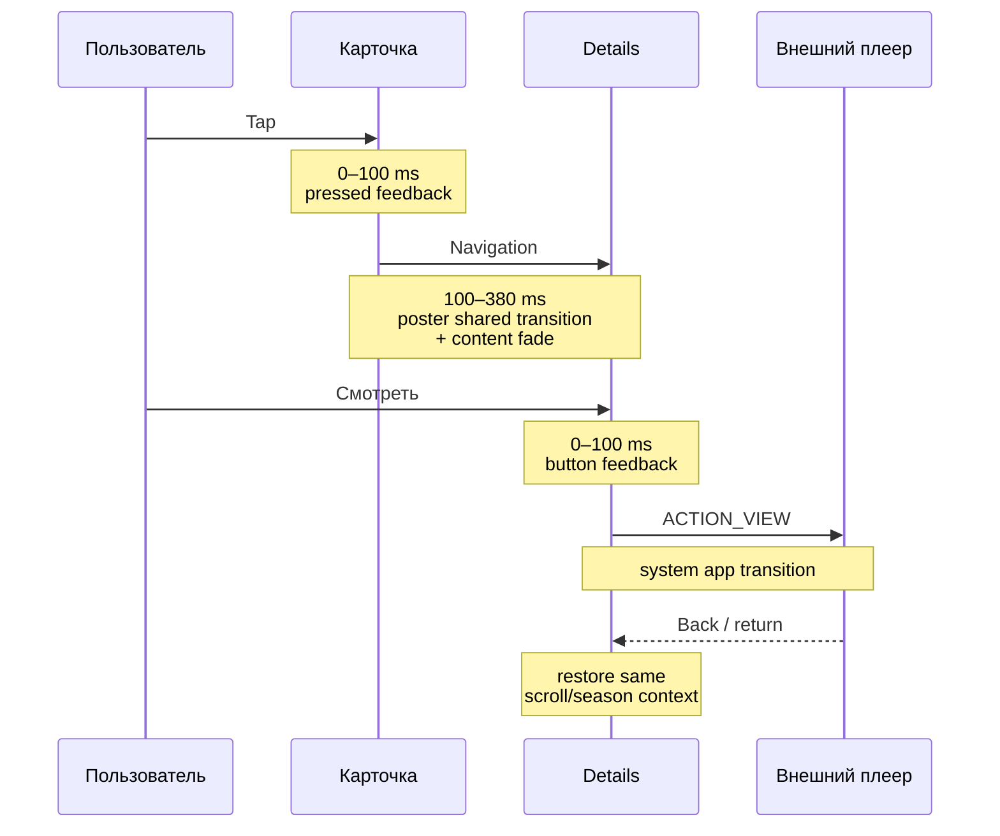
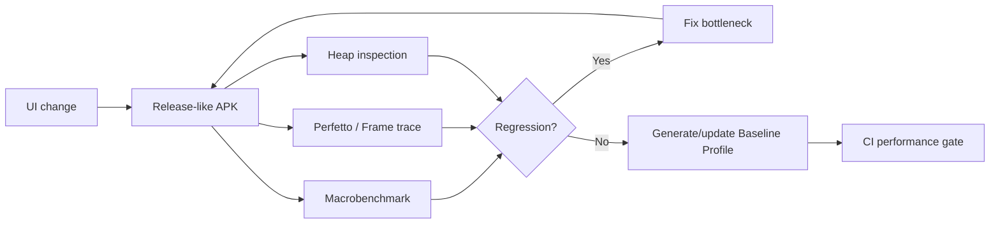

# UI/UX-концепция производительного Android-сервиса для фильмов и сериалов

## Executive summary

Для нового Android-приложения такого типа я бы выбрал **Compose-first архитектуру**: Jetpack Compose + Material 3, `LazyColumn`/`LazyRow`/`LazyVerticalGrid`, Navigation 3, Material 3 Adaptive и Coil для изображений. Для greenfield-проекта в 2026 году XML/RecyclerView уже не даёт достаточного преимущества, чтобы оправдывать дополнительную сложность: Compose хорошо подходит под каталоги с большим количеством повторяющихся элементов, adaptive layouts и сложную визуальную иерархию. Но сам по себе Compose не делает интерфейс быстрым — ошибки с recomposition, изображениями и анимациями способны легко испортить frame time. Google прямо рекомендует оценивать производительность именно release-сборки и отдельно подчёркивает `remember`, stable keys, `derivedStateOf`, deferred state reads и lambda-modifiers как ключевые оптимизации. citeturn21view0turn11view0

На 17 сентября 2026 года официальная Compose BOM в документации — `2026.08.00`; Navigation 3 имеет stable-ветку `1.1.7`, а документация Coil показывает `coil-compose:3.6.2`. Для production я бы фиксировался именно на стабильной Navigation 3 1.1.7, а не на доступной RC-линейке 1.2. citeturn17view0turn19view2turn22view0

Главная продуктовая идея: **приложение должно ощущаться не как Netflix-клон, а как чрезвычайно быстрый визуальный каталог, который доводит пользователя от открытия приложения до запуска фильма за минимальное число действий**. Поскольку видеоплеер внешний, основной UX сосредоточен на discovery: главная → карточка → детали → сезон/серия → «Смотреть» → внешний плеер → возвращение в тот же контекст.

Я бы строил интерфейс вокруг четырёх основных разделов:

| Раздел | Назначение |
|---|---|
| **Главная** | Продолжить просмотр, рекомендации, новинки, популярное |
| **Поиск** | Поиск + быстрые фильтры + результаты |
| **Моё** | Список сохранённого и продолжение просмотра |
| **Профиль** | Профиль, язык, внешний плеер, UI-настройки |

Netflix документирует отдельные паттерны `My List`, `Continue Watching` и профильное пространство `My Netflix`; Disney+ аналогично разделяет Watchlist и настройки между профилями. Это хорошие UX-паттерны, потому что они отделяют каталог от личного контекста пользователя. citeturn0search5turn0search6turn0search9turn10search0turn10search4

Главное отличие от Netflix, которое я бы сделал намеренно: **меньше визуального шума, меньше одновременно конкурирующих CTA, никаких автозапускающихся preview на главном экране и меньше рядов на один viewport**. Это одновременно упрощает интерфейс и уменьшает нагрузку на CPU/GPU, память и сеть. В Netflix и Disney+ есть настройки autoplay/background-video, то есть даже крупные сервисы рассматривают такое поведение как управляемую пользователем функцию, а не обязательный элемент интерфейса. citeturn10search9turn10search11

Приоритеты реализации:

| Приоритет | Решение | Влияние на плавность |
|---|---|---:|
| **P0** | Lazy-компоненты вместо eager layouts | Высокое |
| **P0** | Правильный размер изображений + Coil cache | Высокое |
| **P0** | Stable keys и стабильные UI-модели | Высокое |
| **P0** | Никакой тяжёлой работы внутри composable | Высокое |
| **P0** | Baseline Profiles + release benchmarks | Высокое |
| **P0** | Отказ от autoplay-video на каталогах | Высокое |
| **P1** | Минимум blur, shadow, translucent layers | Среднее |
| **P1** | Adaptive layouts для tablet/foldable | Среднее UX / низкое perf |
| **P1** | Сдержанные переходы 150–300 мс | Среднее |
| **P1** | Предсказуемые размеры карточек до загрузки изображения | Среднее |
| **P2** | Shared-element poster transitions | Низкое/среднее |
| **P2** | Микроанимации selected states | Низкое |

Целевой бюджет кадра — менее приблизительно **16 мс для 60 Гц, 11 мс для 90 Гц и 8 мс для 120 Гц**. Поэтому для современного телефона с 120-герцовым дисплеем «работает без лагов на 60 FPS» недостаточно: каталожные scroll-сценарии стоит отдельно проверять при 120 Гц. citeturn21view1

## Референсы и продуктовые паттерны

**Netflix стоит брать как референс информационной архитектуры, а не как шаблон, который надо визуально копировать.** Его сильные стороны — Continue Watching, My List, разделение профилей и быстрый переход из каталога к конкретному title. Netflix также позволяет удалять элементы из Continue Watching, то есть пользователь контролирует персональные ряды, а не просто терпит алгоритмически сформированный экран. citeturn0search5turn0search6turn0search9

**Disney+ полезен как более спокойный референс структуры профиля и watchlist.** Watchlist разделён по профилям; в настройках профиля присутствуют, в частности, autoplay, background video, язык приложения, ограничения и Junior mode. Для нашего UI это хороший аргумент в пользу принципа: редко используемые поведенческие настройки должны находиться в профиле/настройках, а не захламлять экран фильма. citeturn10search0turn10search4turn10search9turn10search11

**Prime Video полезен скорее как антипример чрезмерной плотности каталога.** Текущая структура сервиса одновременно содержит Home, Movies, TV Shows, Sports, Live TV и многочисленные тематические подборки. Для универсального медиасервиса это объяснимо, но для описываемого приложения я бы сознательно не переносил такую плотность категорий: чем больше rails конкурируют друг с другом, тем слабее визуальная иерархия. Это уже мой UX-вывод из структуры Prime Video, а не утверждение Amazon о собственном интерфейсе. citeturn10search2

**Apple TV полезен как референс «контент прежде chrome» и управления autoplay.** Для предлагаемого дизайна стоит взять сам принцип: постер/кадр и название контента являются главными объектами, а UI вокруг них должен быть визуально вторичным. Apple также предоставляет пользователю управление автоматическим переходом к следующему контенту, что хорошо согласуется с моделью «автоматизацию можно контролировать». citeturn0search3

Сводно:

| Референс | Что взять | Что не переносить буквально |
|---|---|---|
| Netflix | Continue Watching, My List, понятная title page | Большое число rails и конкурирующих промоблоков |
| Disney+ | Чистая profile/watchlist-модель | Чрезмерную зависимость главной от огромного hero |
| Prime Video | Разделение типов каталога | Слишком много категорий на одном уровне |
| Apple TV | Контент-центричный интерфейс | Большие cinematic-анимации везде |
| Material 3 | Accessibility, typography, adaptive navigation | Dynamic Color как обязательную часть бренда |

**Основной UX-принцип:** один экран — одна доминирующая задача.

Для Home это «найти, что смотреть». Для Detail — «решить, смотреть ли это». Для Seasons — «выбрать эпизод». Для Search — «как можно быстрее перейти от запроса к title». Для Settings — «изменить параметр без необходимости понимать внутреннюю структуру приложения».

Предлагаемая навигация:



Я бы **не помещал отдельный пункт «Фильмы» и «Сериалы» в bottom navigation**. Это фильтры каталога, а не самостоятельные задачи пользователя. Их лучше сделать chips/segmented filters на Home или Search. Bottom navigation должен содержать только действительно верхнеуровневые destinations.

## Архитектура UI и технический стек

Для greenfield-проекта мой выбор — **Jetpack Compose**, а не XML.

Это не утверждение «Compose всегда быстрее». Google в своих performance-материалах подчёркивает необходимость измерений, а их собственные benchmark-примеры показывают, что современные версии Compose способны сравняться с View-based UI по scrolling jank; результат всё равно зависит от конкретного приложения. Compose также избавляется от XML inflation для Compose layouts и позволяет runtime пропускать неизменившиеся composables, но цена этого — необходимость понимать stability и recomposition. citeturn11view0turn11view1turn21view4

| Критерий | Compose | XML + Views |
|---|---|---|
| Greenfield | **Рекомендую** | Можно, но преимуществ мало |
| Каталоги | `LazyColumn`, `LazyRow`, grids | `RecyclerView` |
| Adaptive UI | Очень удобно | Больше layout-вариантов |
| Анимации | Очень удобно | Более многословно |
| Состояние | Declarative | Imperative |
| Boilerplate | Меньше | Больше |
| Риск perf-ошибок | Recomposition | Inflation/layout passes |
| Existing legacy app | Необязательно мигрировать сразу | **Логичный выбор** |
| Новый проект 2026 | **Compose** | Только при специфических требованиях |

Compose lazy layouts создают и размещают прежде всего элементы, необходимые для текущего viewport, в отличие от обычных `Column`/`Row`, которые пытаются составить всё содержимое. Это именно тот паттерн, который нужен для сотен постеров и десятков rails. citeturn3view1turn21view0

**Навигация.** Для нового полностью Compose-приложения я бы использовал **Navigation 3 stable 1.1.7**. Navigation 3 специально спроектирован для Compose, даёт приложению явный контроль над back stack и поддерживает сценарии с несколькими одновременно отображаемыми destinations, что особенно удобно для tablet/list-detail UI. На момент этого отчёта AndroidX указывает `1.1.7` как stable; ветка `1.2.0` всё ещё RC, поэтому production-проекту без конкретной необходимости я бы её не выбирал. citeturn18view0turn19view2

**State management.** Поскольку мы намеренно не обсуждаем бизнес-логику, не надо автоматически создавать ViewModel на каждую мелочь. Google рекомендует держать UI state максимально близко к месту использования и поднимать его лишь к минимальному общему предку, который должен его читать или менять. Простые состояния вроде expanded season selector, selected tab или scroll position могут жить в Compose/state holder; наружу лучше отдавать immutable state + callbacks. citeturn20view0

То есть:

```kotlin
@Immutable
data class DetailsUiState(
    val title: String,
    val subtitle: String,
    val description: String,
    val posterUrl: String,
    val backdropUrl: String?,
    val selectedSeason: Int?,
    val seasons: List<SeasonUiModel>
)

@Composable
fun DetailsScreen(
    state: DetailsUiState,
    onWatchClick: () -> Unit,
    onSeasonSelected: (Int) -> Unit,
    onBackClick: () -> Unit,
    modifier: Modifier = Modifier,
) {
    // Только rendering + UI events.
}
```

Screen-level composable должен принимать данные и события, а небольшие компоненты — только необходимый им subset. Это делает preview/testing простыми и уменьшает область invalidation при изменении state. Подход согласуется с официальными рекомендациями по state hoisting и UI layer. citeturn20view0turn20view2

**Модульность.** Не надо уходить в 40 Gradle modules. Для среднего streaming UI я бы начал так:

```text
:app

:core:designsystem
:core:ui
:core:navigation

:feature:home
:feature:search
:feature:details
:feature:library
:feature:profile
:feature:settings
:feature:player-handoff

:benchmark
:baselineprofile
```

Android рекомендует modularization прежде всего как способ разделять responsibilities, уменьшать coupling и облегчать повторное использование. Здесь я бы делил по пользовательским feature, а общие карточки, typography, image composables и theme вынес в `:core:designsystem`/`:core:ui`. citeturn20view1

Не стоит делать `:poster`, `:button`, `:icon`, `:text` отдельными Gradle-модулями — архитектурно это почти ничего не даёт, но увеличивает сложность build graph.

**UI-only ER-схема** может выглядеть так. Это не domain model и не модель базы данных, а только presentation entities:



**Gradle-база.** На текущий момент Compose BOM в официальной документации — `2026.08.00`; BOM является рекомендуемым способом согласовать версии Compose libraries. Kotlin 2.x Compose Compiler управляется вместе с Kotlin Compose Compiler Gradle plugin. citeturn17view0

```kotlin
// app/build.gradle.kts

plugins {
    alias(libs.plugins.android.application)
    alias(libs.plugins.kotlin.android)
    alias(libs.plugins.kotlin.compose)
}

android {
    buildFeatures {
        compose = true
    }

    buildTypes {
        release {
            isMinifyEnabled = true
            isShrinkResources = true

            proguardFiles(
                getDefaultProguardFile("proguard-android-optimize.txt"),
                "proguard-rules.pro"
            )
        }
    }
}

dependencies {
    val composeBom = platform("androidx.compose:compose-bom:2026.08.00")

    implementation(composeBom)

    implementation("androidx.compose.ui:ui")
    implementation("androidx.compose.foundation:foundation")
    implementation("androidx.compose.material3:material3")

    // Adaptive navigation.
    implementation(
        "androidx.compose.material3:material3-adaptive-navigation-suite"
    )
    implementation("androidx.compose.material3.adaptive:adaptive")
    implementation("androidx.compose.material3.adaptive:adaptive-layout")
    implementation("androidx.compose.material3.adaptive:adaptive-navigation")

    // Navigation 3: production stable branch as of 17 Sep 2026.
    implementation("androidx.navigation3:navigation3-runtime:1.1.7")
    implementation("androidx.navigation3:navigation3-ui:1.1.7")

    // Posters / backdrops.
    implementation("io.coil-kt.coil3:coil-compose:3.6.2")
}
```

Compose BOM `2026.08.00`, Navigation 3 `1.1.7` и Coil `3.6.2` соответствуют опубликованным на момент исследования официальным страницам проектов. citeturn17view0turn19view2turn22view0

Для APK release стоит включать R8 и отдельно генерировать Baseline Profiles; Android официально рекомендует Baseline Profile Gradle plugin для автоматизации этого процесса, причём он поддерживает профилирование конкретных пользовательских journeys. citeturn17view1

## Дизайн-система и конкретные экраны

Я бы не использовал чистый `#000000` как основной фон всего приложения. Очень тёмный холодный серый выглядит визуально мягче и позволяет отделить surfaces без постоянного использования shadows.

**Предлагаемая dark-first палитра:**

| Token | Цвет | Назначение |
|---|---|---|
| `background` | `#080A0D` | Основной фон |
| `surface` | `#11151B` | Cards, bars |
| `surfaceElevated` | `#181E26` | Sheet/dialog |
| `onBackground` | `#F5F7FA` | Главный текст |
| `onSurfaceVariant` | `#B5BDC9` | Metadata |
| `outline` | `#343C48` | Divider/border |
| `primary` | `#F5F7FA` | Главный CTA |
| `onPrimary` | `#090B0E` | Текст CTA |
| `accent` | `#FF3B5C` | Progress/accent |
| `error` | `#FF6B6B` | Ошибка |

Главный CTA я намеренно делаю **светлым, а не красным**. Красный остаётся брендовым accent. Это визуально спокойнее Netflix и обеспечивает очень понятную иерархию: светлая «Смотреть» почти всегда является самым заметным интерактивным объектом.

Контраст обычного текста стоит проверять минимум на WCAG AA — 4.5:1 для стандартного текста; для крупного текста допустим порог 3:1. Особенно важно не класть серый текст напрямую поверх poster art без scrim/solid surface. citeturn23view0

Пример Compose-theme:

```kotlin
private val CinemaDarkColors = darkColorScheme(
    primary = Color(0xFFF5F7FA),
    onPrimary = Color(0xFF090B0E),

    secondary = Color(0xFFFF3B5C),
    onSecondary = Color.White,

    background = Color(0xFF080A0D),
    onBackground = Color(0xFFF5F7FA),

    surface = Color(0xFF11151B),
    onSurface = Color(0xFFF5F7FA),

    surfaceVariant = Color(0xFF181E26),
    onSurfaceVariant = Color(0xFFB5BDC9),

    outline = Color(0xFF343C48),
)

private val CinemaTypography = Typography(
    headlineLarge = TextStyle(
        fontSize = 32.sp,
        lineHeight = 38.sp,
        fontWeight = FontWeight.Bold,
    ),
    headlineMedium = TextStyle(
        fontSize = 24.sp,
        lineHeight = 30.sp,
        fontWeight = FontWeight.SemiBold,
    ),
    titleLarge = TextStyle(
        fontSize = 20.sp,
        lineHeight = 26.sp,
        fontWeight = FontWeight.SemiBold,
    ),
    bodyLarge = TextStyle(
        fontSize = 16.sp,
        lineHeight = 24.sp,
    ),
    bodyMedium = TextStyle(
        fontSize = 14.sp,
        lineHeight = 20.sp,
    ),
    labelMedium = TextStyle(
        fontSize = 12.sp,
        lineHeight = 16.sp,
        fontWeight = FontWeight.Medium,
    ),
)
```

Я бы предпочёл platform/system sans-serif вместо отдельного декоративного шрифта для основного UI. Постеры и key art уже создают достаточное количество визуальной индивидуальности.

**Spacing system:**

```text
4 dp  — микрорасстояние
8 dp  — icon/text, metadata
12 dp — внутренний gap
16 dp — основной horizontal padding телефона
24 dp — section spacing
32 dp — крупный section break
```

Это лучше, чем иметь в проекте случайные `13.dp`, `17.dp`, `19.dp`, `27.dp`.

Кликабельные элементы должны иметь минимум примерно **48 × 48 dp touch target**, даже если сама иконка 20–24 dp. Это прямо соответствует Android/Material accessibility guidance. citeturn7search1turn7search6

**Главный экран.**

Цель — пользователь должен за 1–2 скролла увидеть: что продолжить, что сейчас выделено сервисом и какие есть основные подборки.

```text
┌────────────────────────────────────┐
│ MovieBox                      ◯    │
│                                    │
│ ┌────────────────────────────────┐ │
│ │                                │ │
│ │         BACKDROP / HERO        │ │
│ │                                │ │
│ │       THE LAST OF US           │ │
│ │  Drama · 2025 · 18+            │ │
│ │                                │ │
│ │  [ ▶ Смотреть ]   [ + Моё ]    │ │
│ └────────────────────────────────┘ │
│                                    │
│ Продолжить                         │
│ ┌──────────┐ ┌──────────┐ ┌────── │
│ │ 16 : 9   │ │ 16 : 9   │ │       │
│ │━━━━━━░░░░│ │━━━░░░░░░░│ │       │
│ └──────────┘ └──────────┘ └────── │
│                                    │
│ Популярное                         │
│ ┌──────┐ ┌──────┐ ┌──────┐       │
│ │      │ │      │ │      │       │
│ │ 2:3  │ │ 2:3  │ │ 2:3  │       │
│ │      │ │      │ │      │       │
│ └──────┘ └──────┘ └──────┘       │
│                                    │
│ Новинки                            │
│ ...                                │
├────────────────────────────────────┤
│  ⌂          ⌕          ♥       ◯  │
│ Главная     Поиск       Моё   Проф.│
└────────────────────────────────────┘
```

**Hero:** на телефоне примерно 55–65% ширины viewport по высоте, но не целый экран. Использовать static backdrop, а не autoplay-video. Поверх backdrop — нижний gradient/scrim; название, максимум одна строка metadata и два CTA. Я бы не помещал synopsis в hero на телефоне.

**Rails:** `LazyRow`, horizontal content padding 16 dp, gap 10–12 dp. Poster card — ориентировочно 120–136 dp шириной, aspect ratio 2:3. Continue Watching лучше делать 16:9, около 220–240 dp шириной: прогресс и название эпизода читаются значительно лучше.

**Карточка контента.**

Карточка должна быть максимально дешёвой:

```text
┌───────────────┐
│               │
│               │
│    POSTER     │
│      2:3      │
│               │
│               │
└───────────────┘
Название фильма
2026 · 16+
```

Я бы не помещал поверх каждой карточки сразу rating, год, качество, язык, бейдж «новое», избранное и play icon. На grid/rail достаточно poster + title; один дополнительный badge допустим только когда он реально полезен.

Размеры:

| Элемент | Телефон | Tablet |
|---|---:|---:|
| Poster width rail | 120–136 dp | 150–180 dp |
| Radius | 12 dp | 14–16 dp |
| Gap cards | 10–12 dp | 16 dp |
| Title | 14 sp | 14–16 sp |
| Metadata | 12 sp | 12–14 sp |
| Touch target actions | ≥48 dp | ≥48 dp |

**Страница фильма/сериала.**

```text
┌────────────────────────────────────┐
│ ‹                                  │
│ ┌────────────────────────────────┐ │
│ │                                │ │
│ │            BACKDROP            │ │
│ │                                │ │
│ └────────────────────────────────┘ │
│                                    │
│ DUNE: PART TWO                     │
│ 2024 · 2ч 46м · 16+ · ★ 8.5       │
│                                    │
│ [        ▶ Смотреть             ]  │
│                                    │
│ [ + Моё ]       [ Поделиться ]     │
│                                    │
│ Пол Атрейдес объединяется...       │
│                                    │
│ Актёры · Режиссёр · Жанры          │
│                                    │
│ Похожее                            │
│ [poster][poster][poster] →         │
└────────────────────────────────────┘
```

Иерархия:

1. Backdrop.
2. Название.
3. Metadata.
4. **Primary Watch CTA.**
5. Secondary actions.
6. Synopsis.
7. Cast/genre.
8. Related content.

Кнопка «Смотреть» — full-width на телефоне, 48–52 dp высотой. Не стоит прятать её внутри floating button или overlay: это центральное действие экрана.

На tablet layout меняется:

```text
┌────────────────────────────────────────────────────┐
│                                                    │
│       BACKDROP              DUNE: PART TWO         │
│                             metadata               │
│                             description            │
│                             [ ▶ Смотреть ]          │
│                             [ + Моё ]               │
│                                                    │
├────────────────────────────────────────────────────┤
│ Похожее                                            │
│ [poster] [poster] [poster] [poster] [poster]       │
└────────────────────────────────────────────────────┘
```

**Сериалы / сезоны / episodes.**

Не надо делать отдельный экран season picker, если сезонов немного. На Details:

```text
Сезоны
[ Сезон 2  ▾ ]

┌───────────┐  01  Future Days
│   16:9    │      56 мин
│ thumbnail │      Description...
│━━━░░░░░░░ │
└───────────┘

┌───────────┐  02  Through the Valley
│   16:9    │      51 мин
│ thumbnail │
└───────────┘
```

Episode row: thumbnail порядка 128 × 72 dp на небольшом телефоне; title до двух строк; duration — secondary text; synopsis либо одна-две строки, либо отсутствует на очень компактной ширине. Весь row кликабелен, а не крошечная кнопка play.

Для сериалов с десятками сезонов dropdown предпочтительнее горизонтальных chips: `Season 17` не должен заставлять пользователя прокручивать 16 tabs.

**Поиск.**

```text
┌────────────────────────────────────┐
│ ‹  [ 🔍 Фильмы, сериалы...      ] │
│                                    │
│ [Фильмы] [Сериалы] [Жанр ▾]       │
│                                    │
│ Популярные запросы                 │
│ ...                                │
│                                    │
│ Результаты                         │
│ ┌──────┐ ┌──────┐ ┌──────┐       │
│ │      │ │      │ │      │       │
│ │      │ │      │ │      │       │
│ └──────┘ └──────┘ └──────┘       │
│ ┌──────┐ ┌──────┐ ┌──────┐       │
│ │      │ │      │ │      │       │
│ └──────┘ └──────┘ └──────┘       │
└────────────────────────────────────┘
```

Search field — 48–56 dp. На телефоне grid 2–3 columns в зависимости от реальной доступной ширины, а не от модели устройства. Результаты лучше показывать poster grid, а не горизонтальными rails: пользователь уже находится в целевом контексте поиска.

Skeleton при загрузке лучше делать статическим или с очень мягкой ограниченной анимацией. Бесконечный shimmering по десяткам карточек выглядит эффектно на макете, но не помогает пользователю и создаёт постоянную redraw-нагрузку.

**Моё / Library.**

Здесь нужны не бесконечные подборки, а управление личным контентом:

```text
Моё

[Продолжить] [Список] [История]

Продолжить просмотр
┌────────────────────────────────┐
│ thumbnail │ Episode / Movie    │
│           │ 38 мин осталось    │
│           │ ━━━━━━━░░░░░░     │
└────────────────────────────────┘
```

Netflix и Disney+ уже используют отдельные My List/Watchlist и Continue Watching, поэтому пользователю такая модель будет знакома. citeturn0search5turn0search6turn10search0turn10search10

**Профиль.**

```text
┌────────────────────────────────────┐
│ Профиль                            │
│                                    │
│            ┌───────┐               │
│            │ avatar│               │
│            └───────┘               │
│             Богдан                 │
│                                    │
│ Управление профилем             ›  │
│ Настройки                       ›  │
│ Справка                         ›  │
└────────────────────────────────────┘
```

На этом экране не нужны movie posters. Он должен быть визуально спокойным и быстро загружаться.

**Настройки.**

```text
Воспроизведение
  Внешний плеер              System default  >
  Запоминать выбранный плеер          [switch]

Интерфейс
  Тема                       Тёмная    >
  Язык                       Русский   >
  Уменьшить анимации                   [switch]

Каталог
  Autoplay preview                      [off]

О приложении
  Версия
  Лицензии
```

Даже если autoplay-preview технически когда-нибудь появится, я бы оставил default = off.

**Сравнение вариантов экранов:**

| Экран | Вариант A | Вариант B | Рекомендация |
|---|---|---|---|
| Home | Netflix-style большой hero | Компактный hero + больше каталога | **B** |
| Cards | Только poster | Poster + title | **B**, кроме TV |
| Details | Full-screen cinematic | Backdrop + structured content | **B** |
| Seasons | Tabs | Dropdown | **Dropdown** при >4 сезонах |
| Search | Horizontal rails | Grid | **Grid** |
| Library | Poster grid | Compact list | Оба: переключение не требуется, выбирать по section |
| Profile | Artwork-heavy | Settings-oriented | **B** |
| Tablet details | Растянутый phone layout | Two-pane | **Two-pane** |

Пример производительного Home на Compose:

```kotlin
@Immutable
data class MediaCardUi(
    val id: String,
    val title: String,
    val posterUrl: String,
)

@Immutable
data class MediaRowUi(
    val id: String,
    val title: String,
    val items: List<MediaCardUi>,
)

@Composable
fun HomeContent(
    rows: List<MediaRowUi>,
    onMediaClick: (String) -> Unit,
    modifier: Modifier = Modifier,
) {
    LazyColumn(
        modifier = modifier.fillMaxSize(),
        contentPadding = PaddingValues(vertical = 16.dp),
        verticalArrangement = Arrangement.spacedBy(24.dp),
    ) {
        items(
            items = rows,
            key = { row -> row.id },
        ) { row ->
            Column(
                verticalArrangement = Arrangement.spacedBy(12.dp),
            ) {
                Text(
                    text = row.title,
                    style = MaterialTheme.typography.titleLarge,
                    modifier = Modifier.padding(horizontal = 16.dp),
                )

                LazyRow(
                    contentPadding = PaddingValues(horizontal = 16.dp),
                    horizontalArrangement = Arrangement.spacedBy(12.dp),
                ) {
                    items(
                        items = row.items,
                        key = { item -> item.id },
                    ) { item ->
                        MediaPosterCard(
                            item = item,
                            onClick = { onMediaClick(item.id) },
                        )
                    }
                }
            }
        }
    }
}
```

Использование `LazyColumn`/`LazyRow` и стабильных уникальных keys соответствует официальным Compose performance recommendations; keys особенно важны, когда порядок контента меняется, поскольку помогают Compose понять, что объект переместился, а не был уничтожен и создан заново. citeturn21view0

Изображение:

```kotlin
@Composable
fun MediaPosterCard(
    item: MediaCardUi,
    onClick: () -> Unit,
    modifier: Modifier = Modifier,
) {
    Column(
        modifier = modifier
            .width(128.dp)
            .clickable(onClick = onClick),
        verticalArrangement = Arrangement.spacedBy(8.dp),
    ) {
        AsyncImage(
            model = item.posterUrl,
            contentDescription = null,
            contentScale = ContentScale.Crop,
            modifier = Modifier
                .fillMaxWidth()
                .aspectRatio(2f / 3f)
                .clip(RoundedCornerShape(12.dp)),
        )

        Text(
            text = item.title,
            style = MaterialTheme.typography.bodyMedium,
            maxLines = 2,
            overflow = TextOverflow.Ellipsis,
        )
    }
}
```

Coil рекомендует `AsyncImage` для большинства Compose-сценариев именно потому, что он умеет определять необходимый размер загружаемого изображения по constraints и `ContentScale`; это предпочтительнее загрузки полноразмерного poster bitmap, который потом уменьшается до 128 dp. citeturn22view0

## Движение, внешний плеер, accessibility и адаптивность

Анимации здесь должны создавать ощущение непосредственности, а не демонстрировать возможности Compose Animation.

**Предлагаемый motion spec:**

| Событие | Длительность | Анимация | Easing | Perf-риск |
|---|---:|---|---|---|
| Tap feedback | 80–120 мс | ripple / scale 0.98 | ease-out | Низкий |
| Chip selection | 120–160 мс | color/indicator | ease-out | Низкий |
| Image crossfade | 120–180 мс | alpha | linear/ease-out | Низкий |
| Show/hide controls | 150–200 мс | fade | ease-out | Низкий |
| Screen enter | 220–280 мс | fade + 8–16 dp slide | emphasized decel | Низкий |
| Bottom sheet | 250–320 мс | translate | standard | Средний |
| Poster → Details | 280–350 мс | shared element | emphasized | Средний |
| Large blur animation | — | **не использовать** | — | Высокий |

Это предлагаемый project motion spec, а не обязательные Android constants.

Compose предоставляет `AnimatedVisibility`, `AnimatedContent`, transitions и shared-element APIs. Для простого show/hide `AnimatedVisibility` предпочтительнее ручного постоянного `alpha=0`, потому что после exit animation содержимое может быть удалено из Composition. Для часто меняющихся draw-параметров Android также рекомендует по возможности выполнять изменения на draw/layout phase, а не инициировать recomposition на каждый frame. citeturn6view3turn21view0

**Я бы использовал shared transition только для poster → detail.** Это место, где анимация действительно объясняет пространственную связь: пользователь нажал конкретный poster и видит, как тот становится частью detail page. Navigation 3 уже имеет поддержку shared elements между scenes в stable-ветке. citeturn19view2

Не нужно делать shared transition для Settings, Search, Profile, season selector и каждого горизонтального rail — эффект быстро превращается в визуальный шум.

Motion timeline:



**Когда motion нужно уменьшать или отключать:** когда system animator duration scale фактически отключает animations; когда benchmark показывает нарушение frame budget; на TV для элементов, движение которых ухудшает focus tracking; для длинных lists во время scroll; а также для декоративных background animations. Compose поддерживает системное управление длительностью animator animations, поэтому собственные компоненты не должны насильно обходить пользовательскую настройку. citeturn14search5

### UX внешнего плеера

Самое важное архитектурное правило: **не изображать внутри приложения мини-плеер, если плеера фактически нет**.

Flow:

```text
Details
   │
   │ Watch
   ▼
Pressed feedback
   │
   ▼
Проверка / формирование Intent
   │
   ├── compatible player ──────► External Player
   │                                  │
   │                                  │ Back
   │                                  ▼
   │                            Restore Details
   │
   └── no handler ───────────► Error bottom sheet
```

Android рекомендует использовать implicit Intent, когда действие должен выполнить другой подходящий app: приложение указывает action/data/type, а Android выбирает соответствующий handler. При отсутствии приложения, способного обработать Intent, необходимо корректно обработать `ActivityNotFoundException`. citeturn23view3

Минимальный UI-boundary код:

```kotlin
fun Context.openInExternalPlayer(
    mediaUri: Uri,
    mimeType: String = "video/*",
): Result<Unit> = runCatching {
    val intent = Intent(Intent.ACTION_VIEW).apply {
        setDataAndType(mediaUri, mimeType)
        addFlags(Intent.FLAG_GRANT_READ_URI_PERMISSION)
    }

    startActivity(intent)
}
```

Здесь есть важное ограничение: **у generic `ACTION_VIEW` нет универсального стандарта для передачи «название сериала / номер сезона / номер серии / текущая позиция» любому видеоплееру**. URI и MIME type являются стандартной частью intent flow; дополнительные metadata extras имеют смысл только если выбранный внешний плеер документирует собственный контракт. Поэтому generic-интеграцию нельзя проектировать так, будто любой сторонний плеер вернёт playback progress. citeturn23view3

Если конкретный плеер действительно возвращает result, современный Android рекомендует Activity Result APIs вместо старого `startActivityForResult()`/`onActivityResult()`. При этом Android отдельно предупреждает, что activity/process вашего приложения может быть уничтожен, пока внешняя Activity выполняется, поэтому состояние, необходимое после возврата, должно сохраняться независимо. citeturn13view1

Для UI это означает: сохранять хотя бы выбранный season, episode, scroll state и текущий details route. **Не показывать «37% просмотрено» после внешнего плеера, если внешний плеер этого фактически не сообщил.**

Хороший failure UX:

```text
┌────────────────────────────────────┐
│ Не удалось открыть видео           │
│                                    │
│ На устройстве нет совместимого     │
│ приложения для воспроизведения.    │
│                                    │
│ [ Выбрать приложение ]             │
│ [ Отмена ]                         │
└────────────────────────────────────┘
```

Не надо показывать технический текст вроде `ActivityNotFoundException`.

### Accessibility

Compose генерирует semantics tree для accessibility services и позволяет явно управлять semantics, группировкой, traversal и descriptions. Поэтому accessibility нужно закладывать на уровне design-system components, а не «добавлять TalkBack в конце проекта». citeturn20view3

Для movie card хорошая semantics-группа выглядит логически как:

```text
"Dune: Part Two, 2024, фильм"
button
```

а не:

```text
"image"
"Dune"
"Part"
"Two"
"2024"
"button"
```

Постер, возле которого уже присутствует текстовое название, часто является декоративным изображением и может иметь `contentDescription = null`; интерактивная карточка при этом должна иметь понятную общую semantics label. Coil также прямо использует `contentDescription` как accessibility-описание изображения. citeturn22view0turn20view3

Минимальная checklist:

- touch targets не меньше 48 × 48 dp; citeturn7search1turn7search6
- контраст текста не меньше WCAG AA 4.5:1 для обычного текста; citeturn23view0
- состояние не кодируется только цветом;
- focus order совпадает с визуальным reading order;
- progress имеет доступное числовое описание;
- poster art не должен быть единственным носителем названия;
- тестирование при увеличенном system font scale;
- TalkBack должен позволять пройти весь основной flow до «Смотреть».

### Локализация

Все пользовательские строки должны находиться в Android resources, включая labels, content descriptions, accessibility announcements и format strings; Android рекомендует иметь полный default resource set и локализованные alternatives, а Compose previews можно использовать для проверки разных locales и RTL. citeturn23view1

Не делать:

```kotlin
Text("Смотреть")
Text("$year • $duration min")
```

Лучше:

```kotlin
Text(stringResource(R.string.watch))

Text(
    stringResource(
        R.string.media_metadata,
        year,
        durationLabel,
    )
)
```

При русской локализации особенно важны длинные названия жанров и элементов Settings. Поэтому фиксированная ширина кнопок вроде `width(96.dp)` почти всегда хуже `heightIn(min = 48.dp) + horizontal padding`.

### Телефон, планшет и foldable

Android рекомендует адаптироваться к **размеру текущего app window**, а не определять UI через условие «это планшет». Окно может меняться при split-screen, fold/unfold и desktop/windowed режимах. Material 3 Adaptive предлагает `NavigationSuiteScaffold`, который способен переключать bottom navigation на navigation rail в зависимости от доступного окна. citeturn18view2

```text
Compact
┌───────────────┐
│               │
│    Content    │
│               │
├───────────────┤
│ Home Search…  │
└───────────────┘

Expanded
┌────┬─────────────────────────────┐
│ H  │                             │
│ S  │           Content           │
│ ♥  │                             │
│ P  │                             │
└────┴─────────────────────────────┘
```

Для Search, Library и Settings на больших экранах полезен list-detail. Android Adaptive предоставляет `NavigableListDetailPaneScaffold`: на большом окне list и details отображаются рядом, а на маленьком становятся последовательными полноэкранными panes. citeturn18view3

```text
Tablet Search

┌────┬──────────────────────┬─────────────────────────┐
│nav │ Search results       │ Selected title          │
│    │                      │                         │
│ ⌂  │ [poster] Dune       │      BACKDROP           │
│ ⌕  │ [poster] Alien      │                         │
│ ♥  │ [poster] Arrival    │ Dune                    │
│ ◯  │                      │ [▶ Watch]               │
└────┴──────────────────────┴─────────────────────────┘
```

### Android TV

TV я бы рассматривал как **отдельный presentation target**, а не как телефон с шириной 1920 пикселей. Android предоставляет Compose for TV с компонентами, рассчитанными на focus и remote/D-pad input. Документация отдельно подчёркивает TV-ориентированные focus states; мобильный Material UI не стоит просто растягивать на телевизор. citeturn23view2turn6view0

На TV:

- poster cards крупнее;
- заголовок не обязательно показывать постоянно под каждым poster, если focus раскрывает metadata;
- никаких tiny icon buttons;
- focus border/scale должен быть очевиден;
- navigation rail/sidebar лучше bottom bar;
- Detail layout горизонтальный;
- кнопка Watch должна быть первым логичным focus target после metadata;
- внешний player flow должен работать с D-pad без touch-only dialog.

Рекомендуемый matrix:

| Устройство | Navigation | Home | Details |
|---|---|---|---|
| Phone portrait | Bottom bar | Rails | Single column |
| Phone landscape | Bottom bar / compact rail | Wider rails | Two-column при возможности |
| Foldable | Adaptive | Rails/grid | Supporting pane |
| Tablet | Navigation rail | Wider rails/grid | Two-pane |
| TV | TV navigation | Focus rails | Horizontal cinematic |

## Производительность, profiling и технические ограничения

Для этого класса приложения **изображения и scroll — почти наверняка два главных источника UI-нагрузки**. Не сложность кнопки «Смотреть», не Navigation и не DI.

Android указывает frame budgets примерно 16/11/8 мс для 60/90/120 FPS; превышение бюджета приводит к пропуску frame и perceptible jank. Измерять это рекомендуется на release/non-debuggable build и желательно в том числе на более слабом устройстве. citeturn21view1

**Lazy loading — P0, влияние высокое.**

Нельзя:

```kotlin
Column {
    movies.forEach {
        MovieCard(it)
    }
}
```

для большого каталога.

Нужно:

```kotlin
LazyVerticalGrid(
    columns = GridCells.Adaptive(minSize = 120.dp),
) {
    items(
        items = movies,
        key = { it.id },
    ) { movie ->
        MovieCard(movie)
    }
}
```

Compose Lazy layouts создают/размещают content по необходимости для viewport, а stable keys помогают избежать лишних recompositions при изменении позиции элемента. citeturn3view1turn21view0

**Что насчёт view recycling?**

В XML-мире аналог — `RecyclerView`, recycling `ViewHolder` и diffing. В Compose не надо вручную создавать pool карточек: `LazyColumn`, `LazyRow` и lazy grids реализуют собственную модель ленивой composition/reuse. Поэтому попытка завернуть Compose-карточки в RecyclerView только ради «recycling» в новом Compose-приложении обычно бессмысленно усложнит UI. citeturn3view1

**Изображения — P0, влияние очень высокое.**

Coil рекомендует `AsyncImage` в большинстве Compose-сценариев: он учитывает реальный размер composable. `rememberAsyncImagePainter`, напротив, без custom size resolver может загрузить изображение в оригинальном размере. Для poster размером 128 × 192 dp декодировать условный 3000 × 4500 bitmap — именно тот вид лишней работы и памяти, которого надо избегать. citeturn22view0

Кроме того, Coil рекомендует использовать один общий `ImageLoader`: каждый отдельный loader имеет собственные memory cache, disk cache и HTTP client, поэтому создание loader на экран или карточку ухудшает эффективность кеширования. citeturn22view1

```kotlin
class App : Application(), SingletonImageLoader.Factory {

    override fun newImageLoader(
        context: Context
    ): ImageLoader {
        return ImageLoader.Builder(context)
            .crossfade(true)
            .build()
    }
}
```

`SubcomposeAsyncImage` лучше не использовать внутри массивных `LazyRow`/grid без необходимости: Coil прямо отмечает, что subcomposition медленнее regular composition и может быть неудачным выбором для performance-critical `LazyList`. citeturn22view0

**Заранее резервировать geometry — P0/P1.**

Постер:

```kotlin
Modifier.aspectRatio(2f / 3f)
```

Backdrop:

```kotlin
Modifier.aspectRatio(16f / 9f)
```

Это не только визуально аккуратно: layout не должен менять размеры карточки после прихода изображения.

**Recomposition — P0.**

Composable может выполняться очень часто, вплоть до каждого animation frame, поэтому сортировка, фильтрация, string parsing и создание тяжёлых объектов внутри composable — плохая идея. Android рекомендует выносить такие вычисления наружу или как минимум кешировать их через `remember`. citeturn21view0

Плохо:

```kotlin
LazyRow {
    items(
        movies
            .filter { it.visible }
            .sortedByDescending { it.rating }
    ) {
        MovieCard(it)
    }
}
```

Лучше UI получает уже готовую immutable presentation list:

```kotlin
@Composable
fun MovieRow(
    items: ImmutableList<MovieCardUi>,
) {
    LazyRow {
        items(
            items = items,
            key = { it.id },
        ) {
            MovieCard(it)
        }
    }
}
```

**`derivedStateOf` — P1.**

Для состояния, которое меняется очень часто, но UI интересует лишь пороговое событие, `derivedStateOf` снижает количество ненужных recompositions. Android приводит scrolling как типичный пример. citeturn21view0

```kotlin
val listState = rememberLazyListState()

val showTopBarTitle by remember {
    derivedStateOf {
        listState.firstVisibleItemIndex > 0
    }
}
```

Не стоит использовать `derivedStateOf` повсюду; он нужен там, где source state действительно меняется заметно чаще, чем должен обновляться UI.

**Deferred state reads — P1.**

Для frequently changing position/offset лучше использовать lambda version modifier, чтобы изменение могло перейти сразу к layout phase и не запускать composition. Android показывает именно такой подход с `Modifier.offset { ... }`. citeturn21view0

Плохо:

```kotlin
Modifier.offset(y = scrollOffset.dp)
```

для значения, изменяющегося каждый frame.

Лучше:

```kotlin
Modifier.offset {
    IntOffset(
        x = 0,
        y = scrollOffsetProvider(),
    )
}
```

**Overdraw/GPU — P1.**

Я бы запрещал без специального justification:

```text
full screen image
  + blur
  + gradient
  + translucent Surface
  + second gradient
  + shadow
  + animated alpha
```

на каждом rail.

Практическое правило: один root background, один scrim поверх hero, минимум прозрачных full-screen layers, clip только там, где он визуально нужен. Android rendering tools позволяют диагностировать frame rendering/jank, а реальную пользу таких оптимизаций надо подтверждать профилированием. citeturn21view1

**Animations — P1.**

Для анимируемого цвета Android рекомендует по возможности читать быстро меняющееся состояние на draw phase; пример официальной документации использует `drawBehind`, чтобы не выполнять composition/layout на каждый frame. citeturn21view0

То есть декоративные эффектные gradient/background transitions я бы не строил через постоянную перестройку hierarchy.

**Background work — P0.**

Главный thread не должен заниматься тяжёлым decode, сортировкой больших коллекций или другой длительной работой. Android rendering guidance рекомендует убирать длинные операции с UI thread; в Compose тяжёлые вычисления также желательно выполнять вне composable. citeturn21view0turn21view1

Это не значит, что надо делать `Dispatchers.Default` внутри каждой карточки. Напротив: card composable должна практически только читать state и рисоваться.

**Memory — P0/P1.**

Основные правила для этого UI:

- один shared image loader и caches; citeturn22view1
- картинки грузятся под реальный target size; citeturn22view0
- не хранить `Bitmap` в screen state;
- не prefetch десятки экранов каталога;
- не держать full-resolution backdrop после ухода со страницы;
- фиксировать geometry placeholder и loaded image;
- heap dump проверять после длительного scroll по Home/Search.

Android Studio поддерживает heap dump analysis, позволяющий проверять retained objects и memory usage. citeturn21view3

**Baseline Profiles — P0.**

Для этого приложения Baseline Profile должен покрывать реальные пользовательские journeys:

```text
Cold start
    ↓
Home first frame
    ↓
Scroll Home
    ↓
Open Details
    ↓
Scroll Details
    ↓
Open Seasons
    ↓
Back
    ↓
Search
    ↓
Scroll results
```

Android Baseline Profile plugin предназначен именно для генерации и поддержания таких профилей; документация позволяет привязать их к Gradle Managed Devices и автоматически генерировать при release build, хотя automatic generation увеличивает build time. citeturn17view1

Пример:

```kotlin
// :baselineprofile/build.gradle.kts

plugins {
    alias(libs.plugins.android.test)
    alias(libs.plugins.baselineprofile)
}

android {
    targetProjectPath = ":app"

    testOptions.managedDevices.devices {
        create<com.android.build.api.dsl.ManagedVirtualDevice>(
            "pixel6Api31"
        ) {
            device = "Pixel 6"
            apiLevel = 31
            systemImageSource = "aosp"
        }
    }
}

baselineProfile {
    managedDevices += "pixel6Api31"
    useConnectedDevices = false
}
```

Gradle Managed Devices и аналогичная configuration официально документированы Android для Baseline Profile generation. citeturn17view1

**Macrobenchmark — P0.**

Нужны как минимум сценарии:

```text
startupCold
homeScroll
searchGridScroll
openDetails
detailsScroll
backFromDetails
```

Macrobenchmark предназначен для измерения крупных пользовательских сценариев приложения, включая startup и frame performance, и должен использоваться вместо субъективного «у меня на Pixel плавно». citeturn21view2

Целевой pipeline:



**Инструменты, которые я бы использовал обязательно:**

| Инструмент | Что проверять | Приоритет |
|---|---|---:|
| Macrobenchmark | startup, scroll, navigation | P0 |
| Baseline Profiles | startup/hot paths | P0 |
| Perfetto/System Trace | jank/frame timeline | P0 |
| Compose Layout Inspector | recompositions | P1 |
| Memory/Heap dump | retained posters/bitmaps | P1 |
| Animation Preview | motion debugging | P2 |
| GPU/render inspection | overdraw/frame rendering | P1 |
| Accessibility Scanner/TalkBack | semantics/navigation | P0 |

Проверять производительность надо **не в debug build**: Android прямо рекомендует release либо хотя бы non-debuggable build, поскольку debugging меняет runtime characteristics. citeturn21view1

## План внедрения и рекомендуемые источники

Итоговая структура интерфейса:

```text
App
│
├── NavigationSuite
│   ├── Home
│   │   ├── Hero
│   │   ├── ContinueWatching
│   │   └── MediaRows
│   │
│   ├── Search
│   │   ├── SearchField
│   │   ├── FilterChips
│   │   └── AdaptiveGrid
│   │
│   ├── Library
│   │   ├── Continue
│   │   ├── Watchlist
│   │   └── History
│   │
│   └── Profile
│       └── Settings
│
├── Details
│   ├── Hero
│   ├── Metadata
│   ├── WatchCTA
│   ├── Description
│   ├── Seasons
│   │   └── Episodes
│   └── Related
│
└── PlayerHandoff
    ├── External Intent
    ├── Error UX
    └── Return-state restoration
```

**Чек-лист первого этапа — P0.**

Начать с `:core:designsystem`, реализовать palette, typography, spacing, `MediaPosterCard`, `Backdrop`, `PrimaryButton`, `MetadataRow`, `EpisodeRow` и skeleton/placeholder. Затем создать статические Compose Preview для Home, Details, Search, Library, Profile и Settings. Никакая сеть или бизнес-логика для этого не нужна.

Параллельно следует создать UI models, которые неизменяемы и содержат ровно те данные, которые нужны rendering layer. State hoisting оставить минимальным: выбранный season, UI expansion, tab и scroll state — на соответствующем UI-level. Это соответствует официальной рекомендации хранить state максимально близко к месту использования. citeturn20view0

**Чек-лист второго этапа — P0.**

Заменить любые большие `Column`/`Row` на lazy counterparts, добавить stable keys и подключить Coil через единый `ImageLoader`. Использовать `AsyncImage`; проверить, что poster/backdrop имеют фиксированный aspect ratio ещё до загрузки. Не использовать `SubcomposeAsyncImage` в массовых catalog cards без доказанной необходимости. citeturn21view0turn22view0turn22view1

**Чек-лист третьего этапа — P0/P1.**

Добавить Navigation 3, переход card → details, predictive/back flow и восстановление выбранного UI context. Для greenfield Compose app Navigation 3 является современной Compose-first библиотекой; stable release на момент исследования — 1.1.7. citeturn18view0turn19view2

**Чек-лист адаптивности — P1.**

Использовать `NavigationSuiteScaffold`, а не вручную определять `isTablet`. Проверить compact/medium/expanded windows, rotation, split-screen и foldable resize. Для large window Details/Search/Settings рассмотреть list-detail/supporting-pane patterns. citeturn18view2turn18view3

Принципиально:

```kotlin
@Composable
fun AppNavigation() {
    NavigationSuiteScaffold(
        navigationSuiteItems = {
            // Home
            // Search
            // Library
            // Profile
        }
    ) {
        AppContent()
    }
}
```

`NavigationSuiteScaffold` официально рассчитан на автоматическое переключение между navigation bar и rail в зависимости от window characteristics. citeturn18view2

**Чек-лист motion — P1.**

После того как интерфейс уже работает плавно без декоративных animations, добавить только image crossfade, button feedback, screen enter/exit и один shared-element сценарий poster → details. Если переход не удерживает frame budget — shared element должен проиграть производительности, а не наоборот.

**Чек-лист accessibility — P0.**

Пройти Home → Details → Seasons → Watch только с TalkBack; затем только клавиатурой/D-pad. Проверить ≥48 dp touch targets, semantics grouping, focus order, font scale, contrast, длинные строки и RTL. Compose предоставляет semantics infrastructure специально для взаимодействия accessibility services с declarative UI. citeturn20view3turn7search1

**Чек-лист performance acceptance — P0.**

Перед признанием UI «готовым» я бы поставил такие требования:

| Проверка | Acceptance criterion |
|---|---|
| Home scroll | Нет систематического visible jank |
| Search grid | Не деградирует после длительного scroll |
| Details open | Плавный переход без image-size jump |
| Back | Восстанавливается scroll/context |
| Images | Нет original-size decode для thumbnails |
| Memory | После ухода cache стабилизируется, нет неконтролируемого роста |
| 60 Hz | Frame workload укладывается примерно в 16 мс |
| 90 Hz | Критичные scrolling frames стремятся к ≤11 мс |
| 120 Hz | Критичные scrolling frames стремятся к ≤8 мс |
| Release build | Отдельно benchmarked |
| Baseline profile | Startup + Home + Details + Search |
| Accessibility | Основной flow полностью доступен |

Frame budgets 16/11/8 мс соответствуют Android rendering guidance; реальные показатели следует получать Macrobenchmark/Perfetto, а не оценивать глазами. citeturn21view1turn21view2

**Что я бы принципиально не делал:**

- видео в hero по умолчанию;
- `LazyColumn` внутри другого vertical `LazyColumn` без ясной необходимости;
- blur за каждым текстом;
- elevation/shadow на каждой карточке;
- 6–8 пунктов bottom navigation;
- отдельные экраны «Фильмы» и «Сериалы» только ради структуры;
- одновременно poster, backdrop и logo title там, где они дублируют друг друга;
- giant loading spinner на весь Home;
- shimmer на каждом visible placeholder;
- собственный самописный image cache;
- ручной bitmap management;
- universal `AnimatedContent` вокруг больших screen trees;
- принудительный 300–500 мс transition на каждую навигацию;
- предположение, что внешний player обязательно вернёт playback position;
- оптимизацию по ощущениям без release benchmarks.

**Рекомендуемые первичные материалы для дальнейшего чтения:**

| Материал | Зачем читать |
|---|---|
| Android Developers — Compose Performance Best Practices | `remember`, keys, `derivedStateOf`, deferred reads, draw/layout phase citeturn21view0 |
| Android Developers — Slow Rendering | Frame budget, jank, profiling citeturn21view1 |
| Android Developers — Macrobenchmark | Автоматическое измерение startup/frame performance citeturn21view2 |
| Android Developers — Baseline Profiles | Оптимизация startup и hot user journeys citeturn17view1 |
| Android Developers — State Hoisting | Где должен жить UI state citeturn20view0 |
| Android Developers — Modularization | Разделение проекта на feature/core modules citeturn20view1 |
| Android Developers — Adaptive Navigation | Bottom bar → rail и window-size adaptation citeturn18view2 |
| Android Developers — List-detail layout | Tablet/foldable layouts citeturn18view3 |
| Android Developers — Navigation 3 | Compose-first navigation model citeturn18view0turn19view2 |
| Android Developers — Compose Accessibility | Semantics, traversal, accessibility testing citeturn20view3 |
| Android Developers — App Localization | resources, locale/RTL testing citeturn23view1 |
| Android Developers — Compose for TV | D-pad/focus и TV-specific UI citeturn23view2 |
| Android Developers — Sending user to another app | Корректный external-player handoff через Intent citeturn23view3 |
| Coil — Compose | `AsyncImage`, sizing, crossfade, проблемы subcomposition citeturn22view0 |
| Coil — Image Loaders | Singleton loader и memory/disk cache citeturn22view1 |
| W3C WCAG 2.2 Contrast | Проверка text contrast citeturn23view0 |

Многие страницы Android Developers доступны с переключением интерфейса документации на русский язык; в актуальной документации Android русский присутствует среди поддерживаемых языков. citeturn17view0turn20view0

**Финальная рекомендуемая конфигурация** для этого проекта выглядит так:

```text
Kotlin
   │
   ├── Jetpack Compose
   │     ├── Material 3
   │     ├── Lazy layouts
   │     └── Material 3 Adaptive
   │
   ├── Navigation 3
   │
   ├── Coil
   │
   ├── Design System
   │     ├── dark-first palette
   │     ├── 4/8/12/16/24/32 spacing
   │     ├── restrained typography
   │     └── 48 dp interaction targets
   │
   ├── Phone
   │     └── bottom navigation
   │
   ├── Tablet/Foldable
   │     └── rail + multi-pane
   │
   ├── TV
   │     └── Compose for TV / focus-first UI
   │
   ├── External player
   │     └── Android Intent boundary
   │
   └── Performance
         ├── stable immutable UI state
         ├── stable Lazy keys
         ├── correctly-sized images
         ├── singleton ImageLoader
         ├── limited animations
         ├── R8 release
         ├── Baseline Profiles
         ├── Macrobenchmark
         └── Perfetto
```

Если свести исследование к одному архитектурному решению: **я бы строил это не как уменьшенную копию Netflix, а как Compose-native, content-first Android UI с Netflix-подобной информационной архитектурой, Disney+-подобной визуальной сдержанностью, очень дешёвыми catalog cards и практически нулевой декоративной работой во время scroll**. Производительность здесь выигрывается прежде всего не выбором «Compose против XML», а строгим контролем изображений, lazy composition, stability/recomposition, draw complexity и benchmark-driven оптимизацией. Android прямо рекомендует именно такой подход: сначала правильная структура Compose, затем измерения на release build, после чего адресная оптимизация реальных bottlenecks. citeturn21view0turn21view1turn21view2